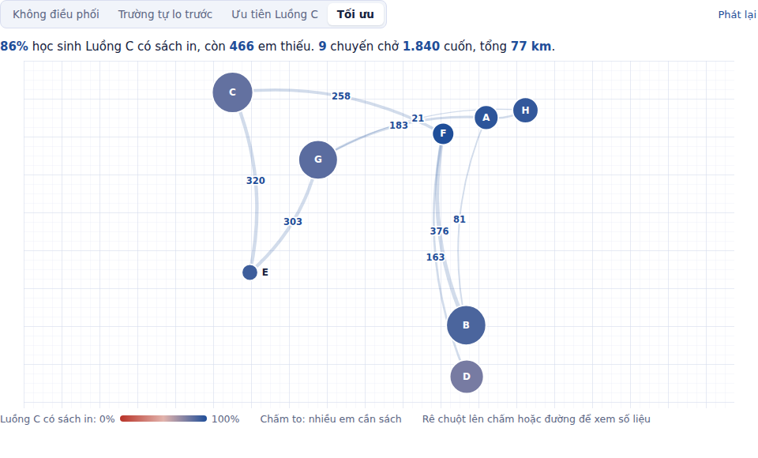
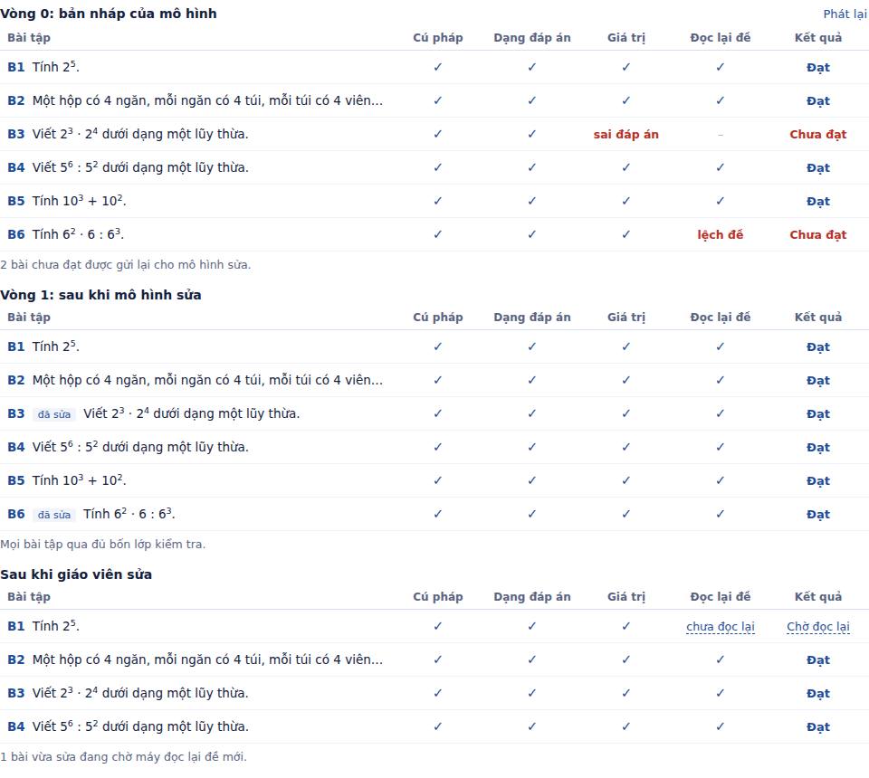
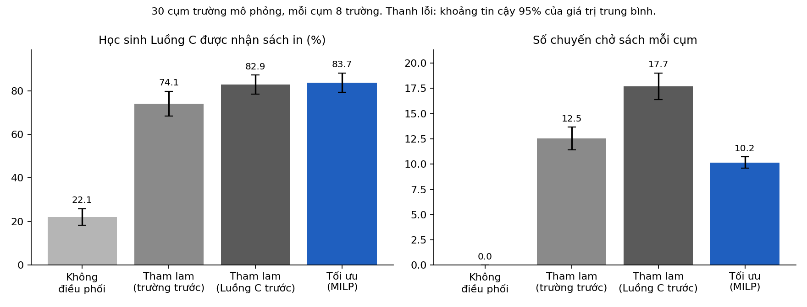

# Cầu Sách

Giữ cho học sinh học đúng chương trình trong lúc chờ sách giáo khoa: chuyển sách thừa tới đúng em cần, và soạn phiếu học tạm có máy kiểm tra đáp án, giáo viên duyệt trước khi in.



## Kết quả chính

**Bộ phân bổ sách** (30 cụm trường mô phỏng, mỗi cụm 8 trường). Chỉ riêng việc điều phối và ưu tiên học sinh không có thiết bị (Luồng C) đã nâng tỷ lệ em Luồng C có sách in từ 22,1% lên 82,9%. Bộ tối ưu đạt 83,7%, với số chuyến chở sách ít hơn 43% so với cách tham lam tốt nhất.

**Bộ sinh Phiếu Cầu** (`gpt-5-mini`, 20 phiếu, báo cáo đầy đủ ở `danh_gia_v5/bao_cao.md`):

- 116/120 bài tập đạt cả bốn lớp kiểm tra ngay ở bản nháp; sau vòng sửa, 121/121 bài và 20/20 phiếu đạt. Khoảng 0,58 cent mỗi phiếu.
- Bộ kiểm tra bắt được 121/121 đáp án bị đổi, 100/100 đáp án sai dạng, và 103/103 trường hợp đổi số trong biểu thức rồi tính lại đáp án cho khớp. Bỏ lớp kiểm tra thứ tư thì loại lỗi cuối chỉ bắt được 0/103.
- Khi mô hình đọc lại đề đã bị sửa: phát hiện 93/94 đề bị đổi số và 121/121 đề bị thêm câu hỏi; báo nhầm 2/121 đề gốc.
- Duyệt nội dung (AI chấm trước, người duyệt lại, 20 bài): 10/20 bài có ít nhất một vấn đề, phần lớn là câu chữ chưa tự nhiên. Máy kiểm được phần toán; câu chữ vẫn cần giáo viên.



Toàn bộ dữ liệu trường học trong kho mã này là dữ liệu mô phỏng.

Mã nguồn cho hai phần của đề xuất Cầu Sách:

1. **Bộ phân bổ sách** (Trụ cột 2, tủ sách luân chuyển): quyết định trường nào chuyển sách nào cho trường nào.
2. **Bộ sinh Phiếu Cầu** (Trụ cột 3): soạn phiếu học tập từ yêu cầu cần đạt bằng mô hình ngôn ngữ, rồi tự kiểm tra đáp án trước khi giáo viên duyệt.

## Phần 1. Bộ phân bổ sách

Phần này hiện thực hóa Trụ cột 2 (tủ sách luân chuyển). Đầu vào là chính bảng theo dõi mà các trường đã điền (Phụ lục B) cùng vị trí các trường. Đầu ra là hai bảng mà điều phối viên dùng được ngay:

- `dieu_chuyen.csv`: trường nào chuyển bao nhiêu cuốn, đầu sách nào, cho trường nào;
- `phan_bo_theo_lop.csv`: mỗi lớp nhận bao nhiêu cuốn cho học sinh không có thiết bị và cho học sinh có thiết bị, và còn bao nhiêu em thuộc Luồng C.

Mục tiêu là đưa sách in tới nhiều học sinh Luồng C (không có sách, không có thiết bị) nhất có thể, đồng thời dùng ít chuyến chở sách nhất có thể.

> **Toàn bộ dữ liệu trong kho mã này là dữ liệu mô phỏng.** Các tham số mô phỏng (tỷ lệ thiếu sách, tỷ lệ có thiết bị, số sách quyên góp…) là giả định để tạo ra một bức tranh thiếu sách có hình dạng hợp lý, không phải số liệu thật. Kết quả bên dưới cho biết phương pháp hoạt động thế nào trên dữ liệu có cấu trúc như vậy, không phải con số dự báo cho một địa phương cụ thể.

### Chạy thử

```bash
pip install -r requirements.txt

# 1. Tạo một cụm trường mô phỏng (8 trường, ~1.300 dòng bảng theo dõi)
python -m causach generate --seed 0 --out data/sample

# 2. Lập kế hoạch phân bổ từ hai tệp CSV
python -m causach plan --schools-csv data/sample/schools.csv --sheet data/sample/sheet.csv --out results/plan

# 3. So sánh với các phương án khác trên 30 cụm mô phỏng (~2 phút)
python -m causach compare --seeds 30 --schools 8 --out results

# 4. Đo thời gian giải khi số trường tăng (~3 phút)
python -m causach scale --sizes 8 16 32 64 --out results

# Kiểm thử
python tests/test_core.py        # hoặc: python -m pytest
```

Lệnh `plan` đọc được bảng theo dõi thật, miễn là có đủ các cột của Phụ lục B. Dữ liệu sai (ví dụ số em không có thiết bị lớn hơn số em thiếu sách) bị từ chối ngay khi đọc.

### Mô hình

Đơn vị là cặp (học sinh, môn), như trong đề xuất. Với mỗi trường $d$ và đầu sách $t$:

- $C_{dt}$: số cặp thiếu sách và không có thiết bị (ứng viên Luồng C);
- $A_{dt}$: số cặp thiếu sách nhưng có thiết bị (đã đọc được SGK điện tử);
- $S_{st}$: số sách thừa trường $s$ có thể cho đi.

Biến quyết định: $x_{sdt}$ là số cuốn đầu sách $t$ chuyển từ trường $s$ sang trường $d$ ($s = d$ là trường tự dùng); $y^C_{dt}, y^A_{dt}$ là số cặp được nhận sách; $z_{sd}$ là số chuyến chở sách từ $s$ sang $d$.

$$
\max \; \sum_{d,t} \big( w_C\, y^C_{dt} + w_A\, y^A_{dt} \big) \;-\; \sum_{s \ne d} \big( c_0 + c_1\, \mathrm{km}_{sd} \big)\, z_{sd}
$$

với các ràng buộc

$$
\sum_d x_{sdt} \le S_{st}, \qquad
y^C_{dt} + y^A_{dt} \le \sum_s x_{sdt}, \qquad
0 \le y^C_{dt} \le C_{dt}, \quad 0 \le y^A_{dt} \le A_{dt},
$$

$$
\sum_t x_{sdt} \le Q\, z_{sd}, \qquad x_{sdt} \le U_{sdt}\, z_{sd}, \qquad \text{mọi biến nguyên.}
$$

Ràng buộc cuối ($U_{sdt}$ là cận trên của $x_{sdt}$) không đổi tập nghiệm nhưng làm nới lỏng tuyến tính chặt hơn, giúp bộ giải nhanh hơn nhiều. Bài toán được giải bằng HiGHS qua `scipy.optimize.milp`; nghiệm trả về được chứng minh nằm trong 0,5% so với giá trị tối ưu.

Mỗi trường chỉ nhận sách từ tối đa 6 trường gần nhất, trong bán kính 15 km. Khoảng cách đường đi được ước lượng bằng 1,3 lần khoảng cách đường chim bay.

#### Trọng số là lựa chọn chính sách

| Tham số | Giá trị | Ý nghĩa |
|---|---|---|
| $w_C$ | 5 | Giá trị của một cuốn sách đến tay học sinh không có thiết bị |
| $w_A$ | 0,5 | Giá trị của một cuốn sách đến tay học sinh đã có thiết bị |
| $c_0$ | 3 | Chi phí cố định của một chuyến chở sách |
| $c_1$ | 0,5 / km | Chi phí thêm theo quãng đường |
| $Q$ | 400 | Số cuốn tối đa một chuyến |

Các con số này cùng đơn vị "cặp học sinh–môn có trọng số". Với giá trị trên, một chuyến 10 km (chi phí 8) đáng đi nếu chở được ít nhất 2 cuốn cho học sinh Luồng C. Đây là quyết định của nhà quản lý, không phải của thuật toán; tất cả nằm trong `causach/model.py` (`Settings`) và có thể đổi.

### So sánh với các cách làm khác

Bốn phương án được chạy trên cùng dữ liệu:

1. **Không điều phối.** Mỗi trường tự phát sách thừa của mình cho học sinh thiếu sách, không biết em nào có thiết bị.
2. **Tham lam, trường tự lo trước.** Mỗi trường phát cho mọi học sinh của mình trước (em không có thiết bị trước), rồi mới nhường phần dư cho trường khác, lấy từ trường gần nhất.
3. **Tham lam, ưu tiên Luồng C.** Học sinh không có thiết bị ở mọi trường trong cụm được phục vụ trước bất kỳ học sinh nào có thiết bị, lấy sách từ trường gần nhất. Đây là phương án so sánh mạnh: nó đã áp dụng đúng quy tắc ưu tiên của Cầu Sách.
4. **Tối ưu (MILP).** Mô hình ở trên.

Kết quả trên 30 cụm mô phỏng, mỗi cụm 8 trường (trung bình ± độ lệch chuẩn giữa các cụm):

| Phương án | Tỷ lệ phủ Luồng C | Luồng C còn lại | Sách điều chuyển | Số chuyến | km |
|---|---|---|---|---|---|
| Không điều phối | 22,1% | 2474 ± 1033 | 0 | 0,0 | 0 |
| Tham lam (trường tự lo trước) | 74,1% | 929 ± 827 | 1606 | 12,5 | 90 |
| Tham lam (ưu tiên Luồng C) | 82,9% | 622 ± 653 | 2064 | 17,7 | 124 |
| Tối ưu (MILP) | 83,7% | 595 ± 655 | 2025 | 10,2 | 68 |



So từng cụm với phương án tham lam ưu tiên Luồng C:

- MILP dùng ít chuyến hơn ở cả 30/30 cụm, tổng số chuyến giảm 43%.
- Số cặp Luồng C còn lại: MILP thấp hơn ở 15 cụm, bằng ở 13 cụm, **cao hơn ở 2 cụm**; trung bình thấp hơn 27,7 cặp mỗi cụm.

Hai cụm MILP để lại nhiều Luồng C hơn là do trọng số: có những chuyến chỉ chở được một hai cuốn cho học sinh Luồng C ở xa, và với $c_0, c_1$ như trên thì mô hình không đi chuyến đó. Nếu chính sách là "mọi em Luồng C đều phải có sách in bất kể chi phí", chỉ cần tăng $w_C$.

Cách đọc đúng của bảng: phần lớn lợi ích đến từ **việc điều phối và quy tắc ưu tiên Luồng C** (từ 22% lên 83%). Bộ tối ưu thêm một phần nhỏ về độ phủ, và phần lớn hơn về chi phí: cùng độ phủ, ít hơn khoảng 4 phần 10 số chuyến.

#### Thời gian giải

| Số trường trong cụm | Trung bình (giây) | Tối đa (giây) |
|---|---|---|
| 8 | 3,6 | 4,1 |
| 16 | 11,4 | 12,9 |
| 32 | 17,2 | 20,7 |
| 64 | 44,7 | 45,6 |

Đo trên máy ảo đám mây thông thường, 2 cụm mỗi cỡ; máy khác sẽ cho số khác. Sách chỉ được chuyển trong bán kính 15 km, nên ở cấp tỉnh có thể chia theo cụm xã, phường và giải từng cụm độc lập.

### Giả định và giới hạn

- Dữ liệu là mô phỏng. Bước tiếp theo đúng nghĩa là chạy trên bảng theo dõi thật của một cụm trường.
- Mỗi môn mỗi khối được coi là một đầu sách; chưa tách tập một, tập hai.
- Sách cũ của các cuốn đã chỉnh sửa theo Thông tư 17/2025/TT-BGDĐT (ở THCS là Lịch sử và Địa lí 6–9) không được tính là sách thừa, vì phải dùng kèm bản điện tử. Có thể bật lại bằng `GeneratorConfig.count_revised_donations`.
- Thông tin có hay không có thiết bị do giáo viên chủ nhiệm ghi nhận; mô hình tin vào số đó.
- Chưa mô hình hóa việc hai em dùng chung một cuốn trên lớp.
- Hệ thống chỉ lưu số lượng, không lưu tên học sinh.

## Phần 2. Bộ sinh Phiếu Cầu

Đầu vào là các yêu cầu cần đạt của Chương trình môn Toán 2018. Bản hiện tại có 10 bài số học lớp 6 với 21 yêu cầu cần đạt (`causach/phieu/data/toan6.json`); các bài này được chọn vì mọi đáp án đều là số, nên máy kiểm được. Mô hình ngôn ngữ (OpenAI) soạn phiếu gồm mục tiêu, kiến thức cốt lõi, ví dụ và bài tập. Mỗi bài tập kèm hai trường cho máy đọc: `bieu_thuc` (biểu thức tính ra đáp án từ số liệu của đề) và `dap_an` (đáp án cuối cùng).

Phiếu không được tin ngay. Nó đi qua vòng lặp **soạn → kiểm tra → sửa bài lỗi → kiểm tra lại**, tối đa 2 vòng sửa. Mỗi bài tập qua bốn lớp kiểm tra:

| Lớp | Kiểm tra | Bắt được |
|---|---|---|
| 1 | Biểu thức và đáp án đọc được bằng bộ phân tích cú pháp an toàn | Lỗi cú pháp; mọi thứ không phải phép tính (đầu ra mô hình không bao giờ được chạy như mã) |
| 2 | Đáp án đúng dạng đề yêu cầu | Ghi 128 khi đề bảo "viết dưới dạng một lũy thừa"; phân số chưa tối giản; phân tích có thừa số không nguyên tố |
| 3 | Đáp án bằng giá trị chính xác của biểu thức (SymPy, số hữu tỉ, không sai số làm tròn) | Đáp án tính sai |
| 4 | Một lần gọi riêng chỉ đọc đề và tự viết biểu thức; hai giá trị phải bằng nhau | Biểu thức và đáp án khớp nhau nhưng không khớp với đề; đề hỏi nhiều kết quả trong khi chỉ một đáp án được kiểm |

Thêm hai kiểm tra nhỏ, có sau khi đọc các phiếu thật đầu tiên:

- Bài đếm người, đồ vật hoặc tiền đồng dùng kiểu `so_nguyen`; nếu kết quả của đề không phải số nguyên (ví dụ "làm được 4,5 cái bánh") thì bài bị đánh lỗi.
- Bài làm tròn mà việc làm tròn không thay đổi số (60 làm tròn thành 60,0) bị đánh lỗi.

Ngoài ra, mỗi yêu cầu cần đạt phải có ít nhất một bài tập đã đạt.

Lớp 4 cần thiết vì lớp 1–3 chỉ chứng minh đáp án khớp với biểu thức do chính mô hình viết. Ví dụ trong bản demo: đề "Tính 6² · 6 : 6³" có biểu thức `6**2*6/6**2` và đáp án 6. Hai trường khớp nhau nên qua được lớp 3, nhưng đáp án đúng của đề là 1. Bài kiểm thử `test_without_cross_check_the_mismatch_slips_through` cho thấy bỏ lớp 4 thì lỗi này lọt qua.

Một bài mà lớp 4 không kiểm được (đề hỏi nhiều ý, hoặc không đọc lại được thành một biểu thức) bị tính là **chưa đạt**, không được cho qua. Quy tắc này có sau lần chạy thật đầu tiên với `gpt-5-mini`: một bài hỏi hai kết quả (bước đọc lại trả về `4**3;7**2`) đã được tính là đạt kèm một ghi chú, dù chỉ một trong hai kết quả được kiểm. Bài kiểm thử `test_unchecked_exercises_never_pass_silently` giữ cho lỗi này không quay lại.

Phần chữ do mô hình viết được chuyển sang cách viết ở trường trước khi in: `3^4` thành 3⁴, `3 * 3` thành 3 · 3. Dấu chấm trong số không bị đổi, vì trong tiếng Việt "120.000" là một trăm hai mươi nghìn.

Máy **không** kiểm: lời văn có hợp với học sinh 11–12 tuổi không, tình huống có thực tế không, lời giải có trình bày đúng cách không, có câu nào giống sách giáo khoa không. Đó là việc của giáo viên khi duyệt bản giáo viên.

### Chạy thử

```bash
cp .env.example .env        # rồi điền OPENAI_API_KEY vào .env
python -m causach lessons   # xem 10 bài và các yêu cầu cần đạt

python -m causach phieu --lesson T6-02 --out kho_phieu             # vòng lặp đầy đủ
python -m causach phieu --lesson T6-02 --rounds 0 --out kho_phieu  # chỉ soạn một lần, để so sánh

python -m causach phieu --demo --out results/phieu_demo   # chạy không cần mạng, mô hình giả lập
```

Mỗi lần chạy ghi bốn tệp vào `kho_phieu/<mã bài>/`: `phieu_hoc_sinh.md` (bản in cho học sinh, không có đáp án), `phieu_giao_vien.md` (đáp án, kết quả kiểm tra từng bài, bảng phủ yêu cầu cần đạt, danh sách việc giáo viên cần xem), `phieu.json` và `kiem_tra.json` (kết quả từng vòng, số lần gọi mô hình, số token).

Kết quả trong `results/phieu_demo/` **không phải đầu ra của mô hình thật**: bản nháp được viết tay, có cài sẵn hai lỗi (B3 sai đáp án, B6 biểu thức không khớp đề), và một mô hình giả lập trả lời theo kịch bản. Bản demo chỉ để thấy vòng lặp hoạt động. Số liệu về mô hình thật sẽ có ở bước đánh giá.

Mô hình mặc định là `gpt-5-mini`; đổi bằng biến `OPENAI_MODEL` trong `.env` hoặc tham số `--model`. Mô hình được gọi qua một giao diện duy nhất (`complete_json`), nên đổi nhà cung cấp chỉ cần viết lại một lớp trong `causach/phieu/llm.py`.

### Dữ liệu và khoá API

- Khoá API chỉ nằm trong `.env` trên máy người chạy; `.env` đã có trong `.gitignore`.
- Mô hình chỉ nhận yêu cầu cần đạt, là văn bản công khai. Mô hình không bao giờ nhận dữ liệu học sinh; dữ liệu đó chỉ đi vào bộ phân bổ ở Phần 1, vốn chạy hoàn toàn trên máy.

### Giới hạn

- Mới có phần số học lớp 6. Hình học và thống kê cần cách kiểm tra khác.
- Giá tiền có hợp lí không (một chiếc áo 250 đồng) chỉ được nhắc trong câu lệnh, máy chưa kiểm.
- Mã yêu cầu cần đạt gắn cho từng bài do mô hình tự ghi; bảng phủ yêu cầu cần đạt có thể đếm thừa nếu mô hình gắn sai.
- Lớp 4 dùng cùng một mô hình để đọc lại đề, nên nếu mô hình hiểu sai đề theo cùng một cách ở cả hai lần, lỗi vẫn lọt. Ngược lại, lớp 4 có thể báo nhầm một bài đúng. Bước đánh giá sẽ đếm cả hai loại.
- Các yêu cầu cần đạt trong tệp dữ liệu được diễn đạt lại ngắn gọn; cần đối chiếu nguyên văn chương trình trước khi dùng chính thức.

## Phần 3. Đánh giá

Ba lần chạy thật đầu tiên với `gpt-5-mini` (bài T6-02, T6-09, T6-10) cho 18/18 bài tập có đáp án đúng ngay từ bản nháp. Vì mô hình hiếm khi sai số học, câu hỏi "vòng sửa giúp được bao nhiêu" nói lên rất ít. Phần đánh giá vì vậy đo ba thứ khác nhau:

1. **Sinh phiếu.** Mọi bài, mỗi bài nhiều lần. Vòng 0 của mỗi lần chính là kết quả soạn một lần, nên một đợt chạy cho cả số liệu "soạn một lần" và "sau vòng sửa" trên cùng bản nháp. Có kèm số token và chi phí.
2. **Thử bộ kiểm tra bằng lỗi cài sẵn.** Lấy các bài đã đạt, cài lỗi đã biết, đếm số lỗi bộ kiểm tra bắt được:
   - đổi đáp án; đúng giá trị nhưng sai dạng; đổi một số trong biểu thức rồi tính lại đáp án cho khớp (lỗi chỉ lớp 4 bắt được). Ba loại này chạy không cần mô hình;
   - đổi một số trong đề; thêm câu hỏi thứ hai vào đề. Hai loại này cần mô hình đọc lại đề;
   - đọc lại đề gốc không cài lỗi, để đếm số lần báo nhầm.
3. **Duyệt nội dung.** Một bảng Excel gồm các bài lấy ngẫu nhiên, với năm tiêu chí máy không chấm được (tiếng Việt tự nhiên, tình huống hợp lí, không tầm thường, đúng yêu cầu cần đạt, lời giải hợp lớp 6). Mỗi ô chọn Đạt, Không đạt hoặc Không áp dụng từ danh sách; mỗi lần Không đạt có lí do ở cột `ghi_chu`. Cột `nguoi_duyet` ghi ai đã chấm. Nếu người chấm là một mô hình AI, báo cáo ghi rõ đây không phải duyệt thủ công; người duyệt lại ghi "đồng ý" hoặc "không đồng ý: lí do" ở cột `y_kien_nguoi_duyet`, và báo cáo đếm tỷ lệ đồng ý.

```bash
python -m causach danhgia sinh --samples 2 --out danh_gia       # 10 bài × 2 lần, khoảng 12 cent
python -m causach danhgia gay-loi --out danh_gia                # lỗi cài sẵn, vài lần gọi mô hình
python -m causach danhgia mau-thu-cong --n 20 --out danh_gia    # tạo danh_gia/thu_cong.xlsx để điền
python -m causach danhgia tong-hop --out danh_gia               # viết danh_gia/bao_cao.md
```

### Lần đánh giá đầu tiên và những gì đã sửa

Đợt đầu tiên (phiên bản v4, `gpt-5-mini`, 20 phiếu, 120 bài tập ở bản nháp) cho kết quả:

- **Không bài nào sai đáp án** ở bản nháp (0/120).
- **Bộ kiểm tra bắt được mọi lỗi cài sẵn không cần mô hình**: 128/128 đáp án bị đổi, 112/112 đáp án sai dạng, 113/113 trường hợp đổi số trong biểu thức rồi tính lại đáp án cho khớp. Bỏ lớp 4 thì loại cuối bắt được 0/113.
- **Mô hình đọc lại đề**: bắt 101/103 đề bị đổi số, 128/128 đề bị thêm câu hỏi, và **không báo nhầm** trên 128 đề gốc. Hai ca "bỏ sót" là lỗi của bộ cài lỗi chứ không phải của mô hình: số bị đổi xuất hiện hai lần trong đề ("12 hộp bút … mua 12 hộp"), chỉ lần đầu bị đổi, nên câu hỏi không đổi và mô hình đọc đúng.

Đợt này cũng lộ ra ba vấn đề, đã sửa trong v5:

| Vấn đề | Nguyên nhân | Cách sửa |
|---|---|---|
| 4/20 phiếu không đạt hoàn toàn dù mọi bài tập đều đạt | Mô hình tự đặt mã yêu cầu cần đạt ("cộng_phân_số" thay vì "T6-09.1") | Trường `yccd` trong JSON schema chỉ nhận đúng các mã của bài (`enum`), nên mô hình không thể ghi mã khác |
| 24 bài bị đánh "chưa đối chiếu được", rồi bị viết lại không cần thiết | Ở cả 4 phiếu trên, bước đọc lại không trả kết quả khớp mã bài tập; vòng sửa coi đó là lỗi của bài | Khớp mã bài tập linh hoạt hơn, thử đọc lại một lần, tách lỗi hệ thống (`loi_doc_lai`) khỏi lỗi nội dung và không bắt viết lại bài khi chỉ bước đọc lại hỏng; lưu câu trả lời thô của bước đọc lại để lần sau tìm được nguyên nhân |
| 2 ca "bỏ sót" giả ở hàng đổi số trong đề | Bộ cài lỗi đổi một số xuất hiện hai lần | Chỉ đổi số xuất hiện đúng một lần trong đề |

Lỗi nội dung thật duy nhất ở bản nháp là 2 bài hỏi nhiều ý (bài T6-08); vòng sửa đã sửa được cả hai.

Bước `sinh` bỏ qua những lần đã chạy xong, nên nếu bị ngắt giữa chừng thì chạy lại lệnh cũ là đủ. Chạy thử toàn bộ quy trình không tốn tiền: `python -m causach danhgia sinh --demo --out danh_gia_demo`, sau đó `gay-loi --offline-only`.

## Ứng dụng

```bash
python -m streamlit run app.py
```

Trình duyệt mở trang `http://localhost:8501` với ba thẻ:

- **Phân bổ sách**: chọn một cụm trường mô phỏng hoặc tải lên bảng theo dõi thật, chỉnh các trọng số chính sách, bấm *Lập kế hoạch*. Bản đồ động cho thấy sách chạy từ trường thừa sang trường thiếu, và màu mỗi trường chuyển từ đỏ sang xanh khi học sinh Luồng C của trường có sách. Các chấm ở quá gần nhau được giãn nhẹ để không chồng lên nhau, và có thể kéo từng chấm sang chỗ khác (bấm *Xếp lại* để trở về cách xếp tự động); vì vậy vị trí trên bản đồ chỉ gần đúng. Có thể xem kế hoạch của từng phương án để so sánh, và tải về danh sách điều chuyển, bảng phân bổ theo lớp.
- **Soạn và duyệt Phiếu Cầu**: chọn bài, bấm *Soạn phiếu* (bản demo không cần mạng; bản OpenAI cần khoá trong `.env`). Bảng kiểm tra động cho thấy từng bài tập đi qua bốn lớp kiểm tra, dừng ở lớp bắt được lỗi, rồi được sửa ở vòng sau. Màn hình duyệt cho giáo viên bỏ bài, sửa câu chữ, *Kiểm tra lại*, rồi *Chấp nhận và lưu vào kho phiếu*. Phiếu chỉ lưu được khi đã có tên người duyệt và không còn bài nào trượt kiểm tra tự động; mỗi lần lưu ghi lại người duyệt, bài bị bỏ, bài bị sửa (`kho_phieu/<mã bài>/<thời điểm>/duyet.json`).
- **Đánh giá**: hiển thị các tệp `bao_cao.md` trong thư mục dự án.

## Kiểm thử

```bash
python tests/test_core.py    # bộ phân bổ: 8 bài kiểm thử
python tests/test_phieu.py   # bộ sinh phiếu: 16 bài kiểm thử, chạy được không cần mạng
python tests/test_danhgia.py # kiểm tra mới và quy trình đánh giá: 9 bài kiểm thử
python tests/test_app.py     # chạy toàn bộ ứng dụng với một Streamlit giả, bấm lần lượt mọi nút
```

## Cấu trúc

```
causach/
  data.py, model.py, optimize.py, baselines.py, metrics.py, export.py   bộ phân bổ sách
  phieu/
    data/toan6.json   yêu cầu cần đạt, 10 bài số học lớp 6
    curriculum.py     đọc dữ liệu chương trình; JSON schema cho đầu ra mô hình
    prompts.py        câu lệnh soạn, sửa và đọc lại đề
    llm.py            giao diện mô hình: OpenAI và mô hình giả lập
    mathcheck.py      bộ tính an toàn, chính xác; kiểm tra dạng đáp án
    verify.py         bốn lớp kiểm tra và phủ yêu cầu cần đạt
    generate.py       vòng lặp soạn → kiểm tra → sửa
    render.py         bản học sinh và bản giáo viên; chuyển ký hiệu sang cách viết ở trường
    store.py          lưu và đọc kết quả từng lần sinh phiếu
    danhgia.py        đánh giá: sinh hàng loạt, lỗi cài sẵn, bảng duyệt thủ công, báo cáo
    demo.py           bản nháp viết tay có cài lỗi, cho bản demo không cần mạng
  app_logic.py        phần xử lý của ứng dụng, tách khỏi Streamlit để kiểm thử được
  ui_components.py    bản đồ động và bảng kiểm tra động (HTML/SVG/JS, không cần thư viện ngoài, chạy được khi không có mạng)
  __main__.py         dòng lệnh
app.py                ứng dụng Streamlit
tests/
data/sample/          một cụm trường mô phỏng mẫu
results/              kết quả so sánh, thời gian giải, kế hoạch mẫu, phiếu demo
```

## Việc tiếp theo

- Chạy bộ phân bổ trên bảng theo dõi thật của một cụm trường.
- Mời giáo viên duyệt cùng bảng `thu_cong.xlsx` để có đánh giá độc lập.
- Thêm kiểm tra tự động cho giá tiền và cho việc lặp đề giữa các lần sinh.

## Giấy phép

Mã nguồn theo giấy phép MIT (tệp `LICENSE`). Phiếu Cầu do hệ thống tạo ra được công bố theo giấy phép CC BY 4.0.
